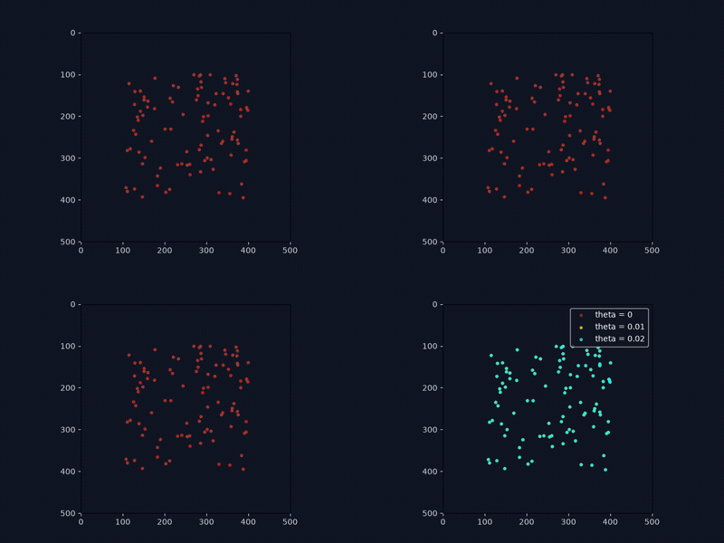
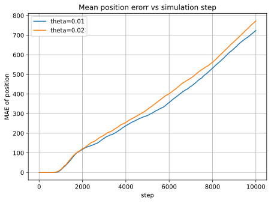

# Project Overview
This project is my second attempt at creating an optimized, working N-Body simulation using the [Barnes-Hut](https://en.wikipedia.org/wiki/Barnes%E2%80%93Hut_simulation) algorithm.

It is composed of several modules:
 - `config.py` is a configuration file containing global constants like `TOTAL_BODIES`, `THETA`, `DT` etc. all being significant variables in the simulation
 - `models.py` contains all class definitions and relevant functions, used in simulations
 - `generate_points.py` hosts logic for generating .CSV files containing initial world states for the simulations
 - `physics.py` hosts all logic describing object behaviour in the simulations
 - `simulate.py` is an entry point for the simulation that takes no inline arguments, however it works off the configured global constants, and snapshots the world in steps into a .CSV file.
 - `render.py` generates images from the simulation .CSV files and composes them into .GIF files.
 - `overlay.py` generates an overlay of multiple simulations from their .CSV files, and composes them into a .GIF file.
 - `analysis.py` compares multiple simulations and analyzes the relationship between $\theta$ (`THETA`) - the tolerance of Barnes-Hut optimization, `dt` - the time step over which the physics of the simulation are integrated, and the summarized statistically numerical error of the optimized simulations.

# Analysis
I have compared the results of the currently implemented version of the algorithm for varying $theta$ and $dt$ values, and summarized them in a few plots and overlay animations for comparison:

Simulations for $dt = 0.0005$, $\theta \in [0.00, 0.01]$ and an overlay of the two:

The Mean Position error seems to become noticeable only after approx. $800$ steps ($dt = 0.0005$) for $\theta$'s on the order of $10^-2$. Beyond this point, the error appears to grow approximately linearly with time, 
with larget values of $\theta$ generally producing greater deviations.

# Goal
I've first learned about the Barnes-Hut algorithm around 2023, while working on a first N-body simulation of my own, optimizing it by migrating maths to numpy and rendering everything in an OpenCV window, as that was the only thing I knew.
At the time I've seen N-body simulations of *millions* of bodies, and researched how they managed to work in real time, and that's how I stumbled upon this specific algorithm.
I had trouble understanding it then, but decided to figure it out completely on my own - therefore I've spent years occasionally picking up on it again, trying to figure out the maths and logic behind how the QuadTrees should work, how to put everything into code, and how to structure the whole project.

I would've spent more time figuring stuff out, changing plans around and modifying the data structures I had in mind, before even beginning to actually write the code, but a scholarship offer recently offered to me has sparked the idea of finally bringing this project to the table, even if that meant it being imperfect.

Thus for the last week, I've spent hours tweaking maths and comparing results from simulations, debugging faulty logic and silly mistakes, to create something, that represents my ambitions finally sprouting from the cold ground, given a drop of a chance and some leftover hope.

